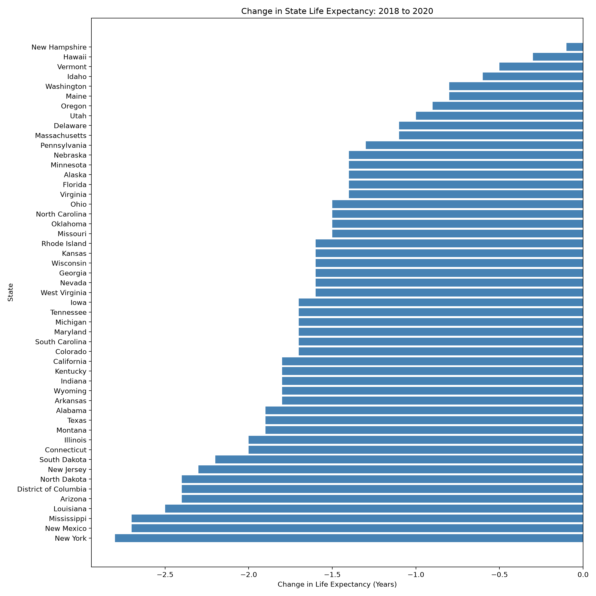
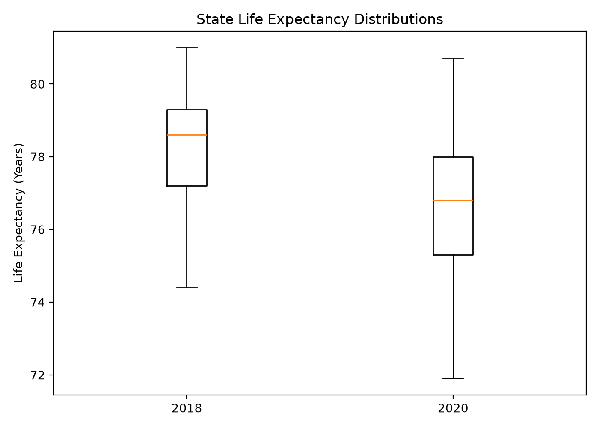
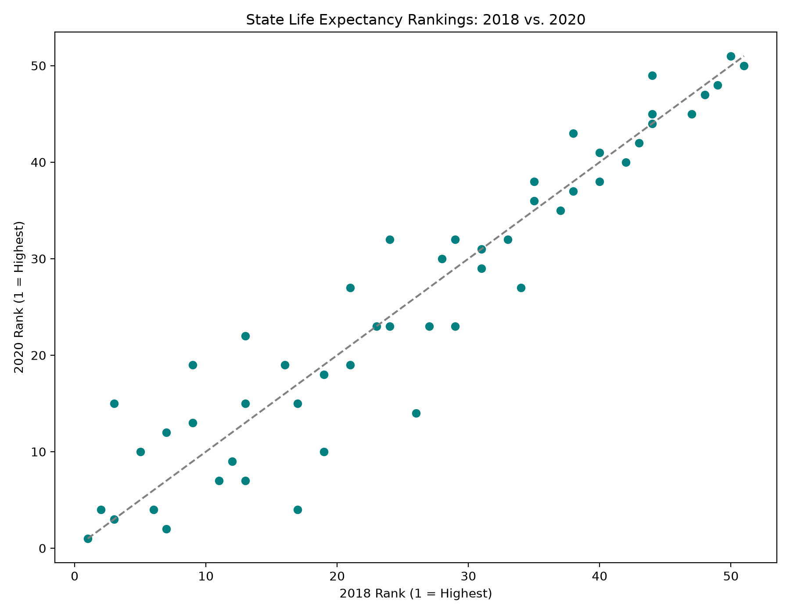

## us-life-expectancy
Project Description: Analysis of life expectancy estimates across U.S. states and D.C.
## Team Name:
Team Time Analyzers
## Contributors: 
Sophie Villar, Reem Mounir, Josie Spayd

## Objective and Motivation:
1. **specify dataset and provide details**

The objective of this project is to investigate a chosen dataset relating to our groups interest and write a functional program aimed at recieving useful information. Our chosen datasets reflects estimates of life expectancy at birth during the year of 2018 and 2020. Within our datasets, the estimates of life expectancy at birth are organized by total, male, and female populations based in each of the fifty states as well as the District of Columbia (D.C.). 

Our motive behind our project focuses on the perspective of a researcher from the U.S. Department of Health and Human Services that is interested in how life expectancies shifted before and during the COVID-19 pandemic. With a range of data spanning two years, any information we extract with our program would be considered valid for confirming a significant comparison. 

2. **specify the questions that you are asking (with the form of the expected answers) and the potential benefits that one would have**

- *Question one: How did the life expectancy gap between males and females change within and across the U.S. from 2018 to 2020?*
    - Expected Answer: We expect that the life expectancy of females will remain higher independent of the year and state. 
    - Potential Benefits: Recognizing that females continued to have a longer life expectancy than males during the pandemic will serve as a larger motive for scientists to investigate deeper into womens health to better identify the factors that contribute to longer life span and apply any findings to all of human kind.

- *Question two: How did state-level variation and rankings in overall life expectancy shift between 2018 and 2020, and which states experienced the largest overall gains or drops?*
    - Expected Answer: Considering the rise of the COVID-19 pandemic in 2020, we expect that the life expectancy estimates should slightly decrease from 2018 to 2020. Additionally, we expect that states with major cities such as New York will have experienced the largest overall drops because the pandemic was spread faster in densly populated areas.
    - Potential Benefits: Identifying the states that were sucessful in avoiding life expectancy losses would allow public health officials to compare the data against regional healthcare response procedures and allocate future healthcare resources accordingly.

- *Question three: How did the relationship between the gender life expectancy gap and overall state life expectancy evolve between 2018 and 2020?*
    - Expected Answer: Since the pandemic impacted different states and genders differently, we expect to see the typical life expectancy gender gap in 2018 to be disrupted during 2020. 
    - Potential Benefits: Knowing the answer to this question would help identify if a certain states health department helped to protect both men and women equally during the pandemic, or if the pandemic widened the health gap between genders.This information would give health officials more insight on who is more vulnerable if a nationwide health emergency happens again.

## Introduction/Context of the Project:
1. this section is not mandatory, but if you feel like some content needs to be introduced in order to understand the methods and questions, please add all necessary details here

Life expectancy is a great way to study the overall population health. However, it varies between males and females in each state. Studying this data allows us to identify the patterns in health across the different regions in the U.S. An important factor to consider while studying the data for these specific years is COVID-19. During 2020 the pandemic had a significant impact on the health of the overall population. We want to see whether the pandemic had an impact on the overall life expectancies of the population as well as if it affected males or females more. This project examines the life expectancy data for 2018 and 2020 to identify the changes in the life expectancy of males and females, the changes in the gap between these expectancies, and the changes in the totals of life expectancies for each state. We will use the dataset to apply statistical analysis, data visualization, and comparison of trends across the U.S. The main goal of this project is to determine the changes of male and female life expectancy across 2018 and 2020, which states had the most changes, and the correlation between high life expectancy and gender. With these findings, we will be able to better understand the patterns of gender based life expectancy across the U.S. in 2018 and 2020 and the affects the pandemic had on it.

## Implementation Details:
1. **go over the methods (with metrics, tools, plots) to be used to answer the question. this is the main body of the repo**

*Question one: How did the life expectancy gap between males and females change within and across the U.S. from 2018 to 2020?*
- Means: 
    - Organize all given data by sex, state, and life expectancy
    - Calculate life expectancy gender gap by subtracting the LE of females by the LE of males
    - Compare the gaps in life expectancy in each state between 2018 and 2020
    - calculate the average gap in life expectancy across the whole US
- Metrics: 
    - mean life expectancy (male and female)
    - average gap in life expectancy in years
    - standard deviation in the gaps in life expectancy
    - minimum and maximum gaps
- Tools: 
    - excel to filter through data, do calculations, and create graphs 
- Plots: 
    - bar chart to compare the average life expectancy gap between 2018 and 2020
    - bar chart to compare life expectancy gaps in each state between 2018 and 2020

*Question two: How did state-level variation and rankings in overall life expectancy shift between 2018 and 2020, and which states experienced the largest overall gains or drops?*
- Means: 
    - organize total life expectancies per state in 2018 and 2020
    - calculate change in totals (2020 data - 2018 data)
    - rank states from highest to lowest totals for both years 
    - find which states have the highest increases and decreases in their totals
- Metrics: 
    - average the total life expectancies across the US
    - standard deviation of totals across the US
    - minimum and maximum totals 
    - change in totals from 2018 to 2020
- Tools:
    - Python with pandas to organize and analyze the data
    - matplotlib to generate graphs
    - VS Code to write and run the Python script
- Plots: 
    - bar charts to compare totals between 2018 and 2020 
    - bar chart showing changes across the US across both years 
    - box plot for distributions of totals across 2018 and 2020
      
*Question three: How did the relationship between the gender life expectancy gap and overall state life expectancy evolve between 2018 and 2020?*
- Means: 
    - calculate the gap in life expectancies between males and females in 2018 and 2020
    - find total life expectancies for each state in 2018 and 2020
    - create a scatter plot to compare the gap in life expectancy and the totals for each state in 2018 and 2020
    - do linear regression to find relationship between these numbers
    - use linear regression data to compere 2018 and 2020 
- Metrics: 
    - find the correlation coefficient to find the strength and direction of the relationship 
    - find R^2 to find the variation in the gaps explained by the totals
    - find the slope to see how the gap changes with the totals increasing 
    - average the gap and totals for each state in 2018 and 2020 
- Tools: 
    - excel to organize all the data, create scatter plots, do linear regression, and find the correlation coefficient
- Plots: 
    - scatter plot gaps vs totals in 2018
    - scatter plot gaps vs totals in 2020
    - add trend lines to both graphs to perform linear regression and compare both years 

2. Screenshots that you feel is necessary to show project's complexity such as block diagrams, snippets, of the code that carries explicitly a method, a top-level code, etc.


                    Figure 1: Plot 2 Code 

- Plot 2: Gender Life Expectancy Gap by State
    - Data Preparation: To compare the gender life expectancy gap across the individual states, 
    the 2018 and 2020 datasets were combined in a single dataframe. The datasets were matched by state names and suffixes were added to differentiate between data from different years.
    - Visualization: The grouped bar chart was difficult to execute, but important to clearly display the gender gap for both years. Different colors were also used to signify the year in which that data aligned with.
    - Formatting: Final commands were used to customize the appearance of the graph. In addition to the functions aimed at providing labels and legends, newer functions were used to ensure clear visibility of the state names.This meant overlap was avoided and labels were rotated to address spacing concerns.

- Plot 3: State Life Expectancy Rankings
    - Data Preparation: To compare the overall life expectancy across individual states, the 2018 and 2020 datasets were combined into a single dataframe. The datasets were matched by state names, and columns were renamed to differentiate between the two years.
    - Visualization: The scatter plot was important for showing how state rankings changed between 2018 and 2020. Each point represents a state, allowing us to compare its ranking in both years.
    - Formatting: Final commands were used to customize the appearance of the graph. Labels were added to identify the rankings for each year, and a diagonal reference line was included to make it easier to identify states that improved or declined in ranking.
  
- Question 3: relationship between overall life expectancy and life expectancy gap between males and females
  - Data Preparation: To compare the gender life expectancy gap and the overall life expectancy, the 2018 and 2020 dataset was loaded separately. It was then organized by state and sex. Additionally, a new column was created by calculating the gender life expectancy gap (female LE - male LE). This column was then used alongside the overall life expectancy column for analysis.
  - Statistical Analysis: To determine the relationship between the 2018 and the 2020 data, linear regression was performed. A correlation coefficient was found to determine the strength and direction of the relationship, the R-squared value was used to determine the variations in the gaps based on the overall life expectancy, and the regression slope was used to determine the trend lines to compare 2018 and 2020.
  - Visualization: Two scatter plots were created to show the relationship between the overall life expectancy and the gender life expectancy gap, one for 2018 and on for 2020. This allows us to better compare the two years.
  - Formatting: The appearance of the scatter plots were customized using final commands. These commands included axis titles, legends, grid lines, and plot titles. The customizations allow for easier visual analysis of the data.The graphs were saved as PNG files in the plot folder for easy access. 

## Results:
1. Question 1 Results:


Figure 2: Plot 1 Generated from Question 1 Script


Figure 3: Plot 2 Generated from Question 1 Script

The results demonstrated that the average life expectancy of both males and females decreased from 2018 to 2020. Male life expectancy decreased from 75.70 to 73.84 years while female life expectancy decreased from 80.72 to 79.43 years. The average gender gap in life expectancy increased from 5.02 years in 2018 to 5.59 years in 2020. This represents a total increase of 0.57 years. In both years, Utah was identified as having the smallest gender gap, with 3.8 years in 2018 and 3.9 years in 2020. The largest gap was identified in New Mexico as 6.2 years in 2018 and the District of Columbia as 7.0 years in 2020. 

2. Question 2 Results:



Figure 4: Change in State Life Expectancy from 2018 to 2020



Figure 5: State Life Expectancy Distributions



Figure 6: State Life Expectancy Rankings from 2018 to 2020

The results demonstrated that the average overall life expectancy across states decreased from 78.21 years in 2018 to 76.59 years in 2020. This represents an average decrease of 1.62 years. The standard deviation increased from 1.70 years in 2018 to 1.96 years in 2020. In 2018, West Virginia had the lowest life expectancy at 74.4 years, while Hawaii had the highest at 81.0 years. In 2020, Mississippi had the lowest life expectancy at 71.9 years, while Hawaii remained the highest at 80.7 years. The largest decrease was identified in New York at 2.8 years, followed by New Mexico and Mississippi at 2.7 years each. The smallest decrease was identified in New Hampshire at 0.1 years. New Hampshire also experienced the largest improvement in ranking, moving from 17th to 4th place, while New York experienced the largest decline, moving from 3rd to 15th place.


3. Question 3 Results:
 

Figure 7: Gender life expectancy gap vs. overall expectancy in 2018


Figure 8: Gender life expectancy gap vs. overall expectancy in 2020


Figure 9: Comparison between 2018 and 2020 data

The results demonstrated that the average overall life expectancy across the U.S. decrease from 78.21 years in 2018 to 76.594 years in 2020. This represents an overall decrease of 1.616 years. The results also demonstrated that the average gender life expectancy gap increased from 5.018 years in 2018 to 5.586 years in 2020. This represents an overall increases of .568 years. This shows that there was an increase in the life expectancy gap from 2018 to 2020. Linear regression was used to observe the relationship between the life expectancy gap and the overall life expectancy. The correlation coefficient in 2018 was -.5108 and in 2020 was -.5866. These negative numbers show a negative relationship which means that the larger overall life expectancies had smaller life expectancy gaps between males and females. The R-squared values increased from .2609 in 2018 to .3441 in 2020. This indicates that the overall life expectancy in 2020 was a larger percentage of the variation in the life expectancy gap than 2018 was. The regression slope decreased from -.1581 in 2018 to -.1763 in 2020. This indicates that the negative relationship gained a steeper slope in 2020. These results show that the average life expectancy deccreased, the life expectancy gap increased, and the negative relationship of the overall life expectancy became stronger. 


## Conclusions: 
1. Question 1 Conclusions: 
Based on the results of the Question1.py script, the difference between female and male life expectancy became larger between 2018 and 2020. While life expectancy decreased for both males and females, the larger decrease in male life expectancy contributed to this larger gap. Ultimately, the results suggest that the gender differences in life expectancy became more significant over this time period. With this, it is important to note that the variation in gender gaps across individual states demonstrate that this conclusion was not consistent throughout the United States.

2. Question 2 Conclusions:
Based on the results of the Question2.py script, overall life expectancy decreased across all states between 2018 and 2020. The average life expectancy decreased by 1.62 years, supporting our original expectation that life expectancy would decline during the COVID-19 pandemic. New York experienced the largest decrease, while New Hampshire experienced the smallest decrease. The increase in standard deviation also demonstrated that the variation in life expectancy across states became greater in 2020. Additionally, the changes in state rankings showed that some states experienced larger decreases than others. Ultimately, the results suggest that life expectancy declined across the United States during this time period, but the impact was not consistent across individual states.

3. Question 3 Conclusions:
Based on the results of the Question3.py script, the overall life expectancy decreased across the U.S. and the life expectancy gap between males and females increased across the U.S.. Alongside this, the correlation coefficient became more negative which indicates a stronger relationship between a high overall life expectancy and a small life expectancy gap in males and females in 2020. These findings support our expectation that life expectancy may have been affected by the COVID-19 pandemic. However, this alone cannot establish that COVID-19 is what actually caused these changes. Ultimately, the results suggest that the relationship between the overall life expectancy and the life expectancy gap between males and females changed from 2018 to 2020. Further data would need to be analyzed in order to better understand the effects of the COVID-19 pandemic on the life expectancy across the U.S.. 


## Actions that need to be completed:
will be populated later
1. list all actions that need to be completed (checklist)

    - Identify methods and metrics to answer questions [✓]
    - Create a GitHub Repo and add the methods and metrics to it [✓]
    - Submit the link of the GitHub repo as a URL for Phase 1 [✓]
    - Create a Python script file for each question [✓]
    - Use print() function to clearly indicate metrics calculated [✓]
    - Use matplotlib to generate graphs [✓]
    - Submit the link of the GitHub repo as a URL for Phase 2 []

2. mention the issues that the group is facing for each action, if any
- N/A

## References/Source Files:
list all references the group used for the project (including journal/conference papers, GitHub repositories, open-source files, etc.)

- 2018 dataset: https://catalog.data.gov/dataset/u-s-state-life-expectancy-by-sex-2018?from_hint=eyJxIjoiVS5TLiBsaWZlIGV4cGVjdGFuY3kgYnkgc2V4Iiwic29ydCI6InJlbGV2YW5jZSJ9  
- 2020 dataset: https://catalog.data.gov/dataset/u-s-state-life-expectancy-by-sex-2020?from_hint=eyJxIjoiZmVtYWxlIiwic29ydCI6InBvcHVsYXJpdHkifQ%3D%3D 
- course canvas page (lecture slides): https://canvas.jmu.edu/courses/2193471/files/folder/Lecture%20Notes  

**this is all used as a key for writing, do not delete anything below!**
paragraph `import matlpotlib`

paragraph *italic* or **bold**

    import matplotlip

OR

``` 
import matplotlib
```

Link [Text](URL)

images as 
